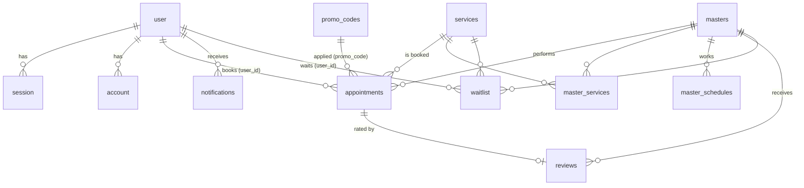

# База даних (Neon Postgres + Drizzle ORM)

Схема: `src/shared/lib/db/db.schema.ts`. Застосування: `npm run db:push`. Тестові дані: `npm run db:seed`, демо-дані акаунта: `npm run db:demo -- <email>`.
Підключення: пул `pg` через `DATABASE_URL` (runtime), міграції через `DATABASE_URL_UNPOOLED`.

| Таблиця | Призначення | Ключові поля |
|---|---|---|
| user | Користувачі Better Auth | id, email (unique), role (client/admin), phone |
| session | Сесії | token (unique), expires_at, user_id |
| account | Облікові дані (хеш пароля) | provider_id, password, user_id |
| verification | Токени верифікації | identifier, value, expires_at |
| services | Послуги | name, duration_min, price, active |
| masters | Майстри | name, specialty, active |
| master_services | Зв'язок M:N майстер-послуга | PK (master_id, service_id) |
| master_schedules | Графік роботи майстра | PK (master_id, weekday), start_min, end_min |
| appointments | Записи | user_id, service_id, master_id, starts_at, ends_at, status, price, discount_percent, promo_code |
| reviews | Відгуки та оцінки | appointment_id (unique), master_id, rating 1-5, comment |
| promo_codes | Промокоди | code (unique), kind (percent/fixed), value, expires_at, max_uses, used_count |
| notifications | Сповіщення в кабінеті | user_id, title, body, read |
| waitlist | Лист очікування на дату | user_id, service_id, master_id, date, notified |

## Правила
- `appointments.user_id` без FK, бо може містити ідентифікатор Clerk (`clerk_...`). Ціна та ім'я клієнта фіксуються на момент запису.
- Статуси запису: `pending -> confirmed -> completed`, або `cancelled`.
- Дані кожного користувача відокремлені: запити клієнта фільтруються за `user_id`.
- Рівень лояльності не зберігається, а обчислюється із суми завершених записів (1 бал за 10 ₴): Bronze 0%, Silver 5% (від 300 балів), Gold 10% (від 800).
- Використання промокоду: `used_count` збільшується атомарним `UPDATE ... WHERE used_count < max_uses`.
