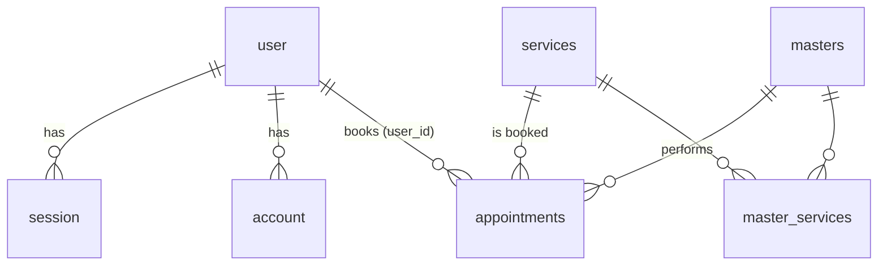

# База даних (SQLite / libSQL + Drizzle ORM)

Схема: `src/shared/lib/db/db.schema.ts`. Застосування: `npm run db:push`. Дані: `npm run db:seed`.

| Таблиця | Призначення | Ключові поля |
|---|---|---|
| user | Користувачі Better Auth | id, email (unique), role (client/admin) |
| session | Сесії | token (unique), expires_at, user_id |
| account | Облікові дані (хеш пароля) | provider_id, password, user_id |
| verification | Токени верифікації | identifier, value, expires_at |
| services | Послуги | name, duration_min, price, active |
| masters | Майстри | name, specialty, active |
| master_services | Зв'язок M:N майстер–послуга | PK (master_id, service_id) |
| appointments | Записи | user_id, service_id, master_id, starts_at, ends_at, status, price |

`appointments.user_id` без FK, бо може містити ідентифікатор Clerk (`clerk_...`). Ціна та ім'я клієнта фіксуються на момент запису.
Статуси: `pending → confirmed → completed`, або `cancelled`.
Дані кожного користувача відокремлені: запити клієнта фільтруються за `user_id`.
